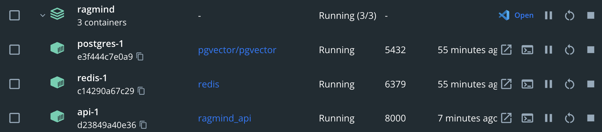
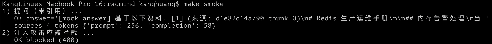
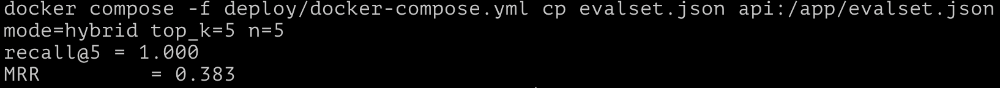

# RagMind：企业知识库 RAG 问答平台

---

## AI 应用架构

| 文件 | 用途 |
|---|---|---|
| `docs/01-rag-architecture.md` | RAG 系统架构 + 生产化设计 |
| `docs/02-rag-design-decisions.md` | 分块 / 检索 / 重排 / 查询改写 | 
| `docs/03-evaluation.md` | 评测方案（RAGAS + 指标 + 数据集） |
| `core/db.py` | 数据库访问：asyncpg 连接池 + PostgreSQL(应用pgvector扩展成向量数据库)的写入与检索 | 
| `core/embedding.py` | 可插拔嵌入层,测试用mock,并为 OpenAI词嵌入和本地词嵌入预留出接口 | 
| `core/llm.py` | 可插拔 LLM 层，带 token 核算,测试用mockLLM,并为OpenAI LLM和本地LLM预留出接口  | 
| `core/chunking.py` | 分块策略：固定长度 vs 语义分块 | 
| `core/retrieval.py` | 检索：混合检索（向量 + 全文）+ 可选重排,并做元数据过滤下推到SQL | 
| `core/guardrails.py` | 注入检测 + 答案溯源校验 |
| `services/api/` | FastAPI 问答接口（流式、缓存、限流、防注入、token 核算） | 
| `services/ingest/` | 文档摄入（解析 → 分块 → 嵌入 → 入库） |
| `sql/` | pgvector 表结构 + 混合检索索引 |
| `scripts/` | 评测脚本 + 样例数据生成 |
| `deploy/` | docker-compose + K8s（含 vLLM 推理服务）与OpenAI 兼容。生产用 GPU 的 vLLM，本地可换成 llama.cpp server | 

---

## 快速开始

```bash
cd ragmind
cp .env.example .env
make up            # 起 postgres(pgvector) / redis / api
make seed          # 造样例文档 + 嵌入入库
make smoke         # 注入检测
make eval          # 跑一轮 RAGAS 评测，产出基线分
make check         # 语法 + 导入 + SQL 静态检查
```

---

## 技术选型

| 层 | 选型 | 理由 | 替选 |
|---|---|---|---|
| 应用框架 | FastAPI + uvicorn | 异步、流式 SSE 原生 | — |
| 向量库 | **pgvector**（PostgreSQL） | 复用企业可能已有的PostgreSQL，向量 + 全文 + 元数据过滤同库解决，避免再加一个专用向量库 | Qdrant / Milvus / Chroma |
| 嵌入 | 可插拔：本地 bge / OpenAI | 默认 mock（离线可跑），生产切 bge-small-zh 或 text-embedding-3 | — |
| LLM | 可插拔：OpenAI / vLLM（OpenAI 兼容） | 默认 mock；推理服务用 vLLM 上 K8s | — |
| 缓存 | Redis | 语义缓存 + 限流 + 幂等 | — |
| 可观测 | Prometheus + token 计数器 | token 成本也是可观测的一部分| LangSmith / LangFuse |


---
## 本地复现


---

---

---