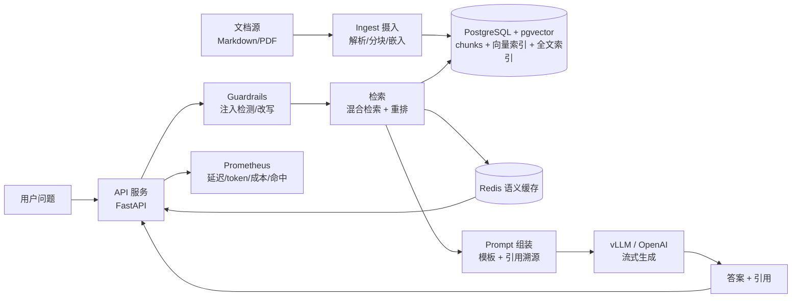

# RagMind · RAG 系统架构

> 这份文档回答：**一个生产级 RAG 系统长什么样，每一层为什么存在，坏的时候会怎样。**

---

## 1. 背景与目标

**业务背景**：企业知识库问答。文档来源是内部技术文档 / 产品 FAQ / 运维手册，总量约 5 万篇、平均 2k token/篇。用户是内部员工，通过问答快速找到答案，**必须能溯源**

**要解决的问题**：
1. 直接问 LLM 会**幻觉**，而且不知道企业内部知识
2. 朴素 RAG（切块 → 向量检索 → 塞给 LLM）在 5 万篇规模下**召回质量差**，答非所问
3. 没有评测，改一个参数不知道是变好还是变坏

**目标（可量化）**：

| 指标 | 目标 |
|---|---|
| 检索 recall@5 | ≥ 0.85 |
| 答案忠实度（faithfulness） | ≥ 0.8 |
| 首 token 延迟 | < 1.5s |
| 完整回答延迟 P99 | < 8s |
| 可用性 | 99.5% |
| 单次问答平均成本 | < [X] 元（缓存命中后 < [X/20]） |

**明确不做**：多模态、Agent 工具调用、多租户权限（留接口）、实时增量同步（先做全量重建）。

---

## 2. 总体架构



**两层流水线**：
- **离线（ingest）**：文档 → 分块 → 嵌入 → 入库。可以慢、可以重跑、可以批处理。
- **在线（query）**：问题 → 改写/守卫 → 检索 → 重排 → 生成。对延迟敏感，必须做缓存和降级。

---

## 3. 每一层「去掉会怎样」

| 层 | 去掉会怎样 | 保留理由 |
|---|---|---|
| 分块 | 检索粒度不对，召回碎或噪音大 | 检索质量的第一决定因素 |
| 嵌入 | 无法语义检索，只能关键词 | 语义匹配 |
| 混合检索 | 纯向量漏掉精确关键词（型号、错误码） | 语义 + 精确互补 |
| 重排 | top-20 里正确的排在第 12 位，被截断 | 用更强的模型只算 20 条，成本可控 |
| 查询改写 | 「上次那个怎么配」这类口语化/多义词问题直接检索失败 | 提升召回 |
| 守卫（注入/溯源） | 用户 prompt 注入改写系统指令；答案无法溯源却装知道 | 安全 + 可信 |
| 缓存 | 热点问题每次都全量检索+生成，成本放大 20 倍 | 成本与延迟 |
| 评测 | 改参数全凭感觉 | 可复现的质量基线 |

---

## 4. 关键设计决策（摘要）

详见 `docs/02-rag-design-decisions.md`：

1. **向量库用 pgvector 而非专用向量库**——因为要「向量 + 全文 + 元数据过滤」同库 JOIN
2. **分块策略由评测集决定**，不是拍脑袋
3. **混合检索的权重由 recall 曲线调出来**，有数据支撑
4. **重排只做 top-20**，用更贵的模型换更准的排序，成本可控
5. **语义缓存**用「归一化问题 + 嵌入相似度」命中，TTL 决定新鲜度

---

## 5. 生产化设计

### 5.1 流式

回答接口支持 SSE。**首 token 延迟比完整延迟更重要**——用户感知 1.5s 和 8s 是两回事。
vLLM 的 continuous batching + streaming 是这套设计的底座。

### 5.2 缓存

```
问题 → 归一化 → 查语义缓存(嵌入相似度 > 0.95)
  ├─ 命中 → 直接返回（成本 ≈ 0，P99 ≈ 20ms）
  └─ 未命中 → 检索 + 生成 → 回填缓存(TTL)
```

热点问题（登录、报销、权限类 FAQ）命中率可到 60%+，这是**成本账里最粗的一根杠杆**。

### 5.3 限流与防注入

- 按用户/租户令牌桶限流（复用架构师项目的思路）
- 注入检测：用户输入里出现「忽略/override/你是」+ 系统指令特征 → 拒绝或改写
- 溯源约束：prompt 里强制「只能根据给定资料回答，资料没有就说不知道」，生成后校验答案与 chunk 的重叠

### 5.4 可观测

| 指标 | 含义 | 为什么重要 |
|---|---|---|
| `rag_retrieve_seconds` | 检索延迟 | 定位慢在检索还是生成 |
| `rag_tokens_total` | prompt/completion token | 成本核算 |
| `rag_cache_hit_ratio` | 缓存命中率 | 成本与延迟的直接杠杆 |
| `rag_guard_rejected_total` | 被拒原因 | 安全事件计数 |
| `rag_grounded_ratio` | 答案可溯源比例 | 幻觉的代理指标 |

### 5.5 灰度与回滚

模型升级是最高频、最危险的变更。方案：

```
vLLM 新版本 5% 金丝雀 → 观察 30 分钟（评测分 + 错误率 + P99）
  ├─ 通过 → 25% → 100%
  └─ 不通过 → 立即回滚（切回旧模型权重，无需重启）
```


---

## 6. 风险与待定项

| 风险 | 影响 | 缓解 | 状态 |
|---|---|---|---|
| 文档更新不同步 | 答案过时 | 增量重建 + 版本号 | 待实现 |
| 向量索引随数据量退化 | recall 下降 | HNSW 参数调优 + 定期重评 | 待验证 |
| 模型幻觉 | 答错 | 溯源约束 + 忠实度评测 | 已加守卫 |
| prompt 注入 | 越权/泄露 | 注入检测 + 溯源约束 | 已加 |
| GPU 成本 | 贵 | batching + 缓存 + 量化 | 待测 |

---

## 附录：文档自查清单

- [ ] 每层能回答「去掉会怎样」
- [ ] 每个质量结论有评测数据
- [ ] 至少一个明确「不做」
- [ ] 至少一个失败实验（分块 or 索引）
- [ ] 成本、延迟、质量三者都有量化
